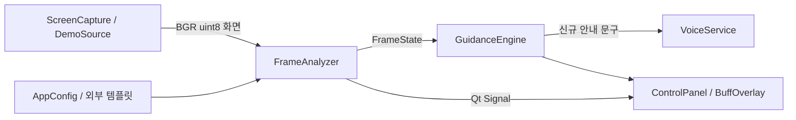

# 구조와 인터페이스

초기 구현은 캡처, 화면 인식, 기믹 판단, 화면 표시, 음성을 분리함. 게임 화면에서 읽은 결과만 사용하며, 게임 프로세스 메모리 접근이나 입력 자동화는 구현하지 않음. 기본 설정에는 실제 게임 템플릿과 레이드 규칙이 없으므로 보정 전 결과는 `unknown`임.

## 파일 구성

| 위치 | 역할 |
| --- | --- |
| `src/loa_raid_helper/domain.py` | ROI, 템플릿, 보스 읽음, 프레임 상태, 설정 자료형을 정의함 |
| `config.py` | JSON 설정을 검증하고 설정 기준 상대 리소스 경로를 해석함 |
| `capture.py` | 지정 모니터의 화면을 BGR 영상으로 캡처함 |
| `vision.py` | 앵커·아이콘 템플릿 비교와 HP 숫자 OCR을 수행함 |
| `guidance.py` | 연속 관측을 확인하고 보스별 HP 임계값 통과를 안내함 |
| `demo.py` | 자체 생성 템플릿으로 가상의 레이드와 대기실을 재현함 |
| `ui.py` | 제어 패널, 작업 스레드, 입력 통과 오버레이를 제공함 |
| `voice.py` | Qt TextToSpeech의 한국어 음성과 짧은 안내 대기열을 관리함 |
| `cli.py`, `__main__.py` | 데모, 설정 생성, 이미지 분석, 통합 검증 진입점임 |
| `tools/calibrate.py` | 스크린샷 ROI 선택, PNG 템플릿 저장, 출처·해시 기록을 지원함 |
| `tools/evaluate.py` | 이미지 묶음의 인식 결과, 처리 시간, 선택적 정답 지표를 출력함 |
| `loa_raid_helper.spec` | OCR 모델과 Qt 의존성을 포함하는 PyInstaller 설정임 |
| `requirements-lock.txt` | 클라우드에서 검증한 직접·간접 패키지 버전을 고정함 |
| `local/` | 개인 스크린샷, 프로필, 템플릿, 평가 결과를 보관하는 Git 제외 경로임 |

## 주요 인터페이스

| 인터페이스 | 입력 | 출력·계약 |
| --- | --- | --- |
| `ROI(x, y, width, height)` | 화면 기준 0~1 정규화 좌표 | 화면 밖 영역, 비유한 값, 0 이하 크기를 거부함 |
| `ROI.crop(frame)` | NumPy 화면 | 화면 크기에 맞춘 부분 영상임 |
| `load_config(path)` | JSON 경로 | 검증한 `AppConfig`이며 템플릿 경로는 JSON 위치 기준임 |
| `ScreenCapture(monitor).next_frame()` | 1부터 시작하는 모니터 번호 | `numpy.ndarray`, `uint8`, `(H, W, 3)`, BGR임 |
| `ScreenCapture.close()` | 없음 | 캡처를 생성한 스레드에서 연결을 해제함 |
| `FrameAnalyzer(config, ocr=None).analyze(frame)` | BGR 3채널 `uint8` 영상 | 현재 프레임의 `FrameState`임 |
| OCR 교체 어댑터 | `Callable[[BGR ndarray], tuple[str, float]]` | 읽은 문자열과 0~1 신뢰도를 반환함 |
| `GuidanceEngine(config).process(state)` | 시간 순서의 `FrameState` | 이번 관측에서 새로 확인한 안내 문구 `tuple[str, ...]`임 |
| `DemoSource.frame(hp_lines=175, phase=RAID, show_buff=True)` | 합성 장면 조건 | 평가용 정적 프레임이며 실제 게임 리소스를 사용하지 않음 |
| `DemoSource.next_frame()` | 없음 | 대기실·HP 감소 장면을 반복하는 데모 프레임임 |
| `run_ui(config, demo=False)` | 설정과 데모 여부 | Qt 이벤트 루프 종료 코드를 반환함 |
| `VoiceService.say(message)` | 짧은 한국어 문구 | 사용 가능한 한국어 음성이 있을 때 재생함 |

`FrameState`에는 `timestamp`, `phase`, `boss`, `buffs`, `classes`가 포함됨. `phase`는 `unknown`, `lobby`, `raid` 중 하나임. `BossReading`은 `boss_id`, `hp_lines`, `confidence`, `verified`를 포함하며 HP 인식 실패는 `hp_lines=None`으로 표현함. `IconMatch`는 템플릿 ID, 표시 이름, 일치 점수, 시너지 문구를 포함함. `timestamp`는 시스템 단조 시각이므로 날짜나 사용자 시각으로 해석하면 안 됨.

## 실행과 스레드

`MonitorWorker`는 Qt 작업 스레드에서 캡처와 인식을 수행함. 결과는 Signal로 전달하고 UI 위젯은 주 스레드에서 갱신함. 캡처 객체는 사용 스레드에서 생성하고 종료함. UI의 갱신 간격은 최소 100ms이며 기본값은 500ms임. 처리 시간이 간격보다 길면 실제 갱신 속도는 인식 시간에 제한됨.

제어 패널에서 모니터, 갱신 간격, 음성 사용 여부, 오버레이 위치를 조절함. 오버레이 X·Y 값은 현재 실행 동안만 적용되며 앱을 다시 시작하면 화면 중심 기준 기본 위치로 초기화됨. 오버레이는 사용자가 지정한 고정 위치에 HP와 버프 이름을 표시함. 캐릭터 위치 추적, 스킬 쿨다운 수치 해석, 스킬·버프 조합 조건은 초기 구현 범위에 포함되지 않음. 대기실 클래스는 검출된 템플릿 종류별로 표시하므로 같은 직업의 인원 수나 파티 슬롯은 계산하지 않음.

## 기믹 판단 정책

레이드 앵커와 보스 앵커가 모두 등록되어 있어야 함. `raid` 단계, 검증된 보스, 양수 HP, 설정 범위 이내 HP, OCR 신뢰도 기준을 모두 충족한 관측만 사용함. 같은 보스의 연속 `stable_frames` 관측에서 최대 HP가 임계값 이하로 내려가야 통과로 확인함. 기본 `stable_frames`는 2임.

인접 읽음에서 HP 증가가 2줄을 초과하거나 급락이 `max(3, ceil(max_hp_lines × 0.01))`을 초과하면 후보 관측을 새로 모음. 같은 시각의 중복 입력을 세지 않으며, 관측 간격이 `max(2초, interval_ms / 1000 × 4)`를 초과해도 후보를 끊음. 이 기준은 실제 피해 속도와 레이드 HP 범위에 맞춰 검증해야 함.

첫 안정 관측에서 이미 지난 임계값은 안내하지 않음. 첫 창의 모든 읽음이 정확히 임계값과 같으면 해당 기믹만 안내함. `unknown`, 미검증 보스, 낮은 신뢰도 관측은 후보 관측을 지우지만 기존 기믹 안내 이력은 유지함. 연속 `stable_frames`만큼 대기실을 확인하거나 다른 보스가 안정화되면 전투 안내 이력을 초기화함. 같은 보스 재시작에서 대기실이 보이지 않거나 보스가 HP를 회복하는 상황은 모니터링 정지·재시작으로 상태를 초기화해야 함.

이 정책은 단발 OCR 오류를 줄이기 위한 초기 방어임. 합성 화면 검증은 실제 레이드 정확도와 기믹 타이밍을 보장하지 않음. 실제 규칙은 보스 앵커 ID와 HP·메시지를 검증한 뒤 `rules`에 등록해야 함.

## 확장 지점

인식 기술을 바꿀 때는 BGR 입력과 `FrameState` 출력 계약을 유지함. 숫자 OCR은 callable 어댑터로 교체 가능함. 새로운 클래스·버프는 코드 수정 없이 설정의 템플릿 목록에 추가함. 여러 보스 프로필, 파티 슬롯별 클래스 중복, 쿨다운 상태, 캐릭터 추적이 필요하면 각 기능의 상태 자료형과 검증 자료를 먼저 정의해야 함.

개발 환경은 Python 3.12 기준임. Anaconda와 일반 `venv` 중 하나를 사용할 수 있으며 같은 고정 패키지를 설치함. 새 클라우드 작업에서도 기존 `/workspace/loa_raid_helper` 체크아웃을 사용함. 별도 Git worktree는 사용자가 요청할 때만 생성함.
